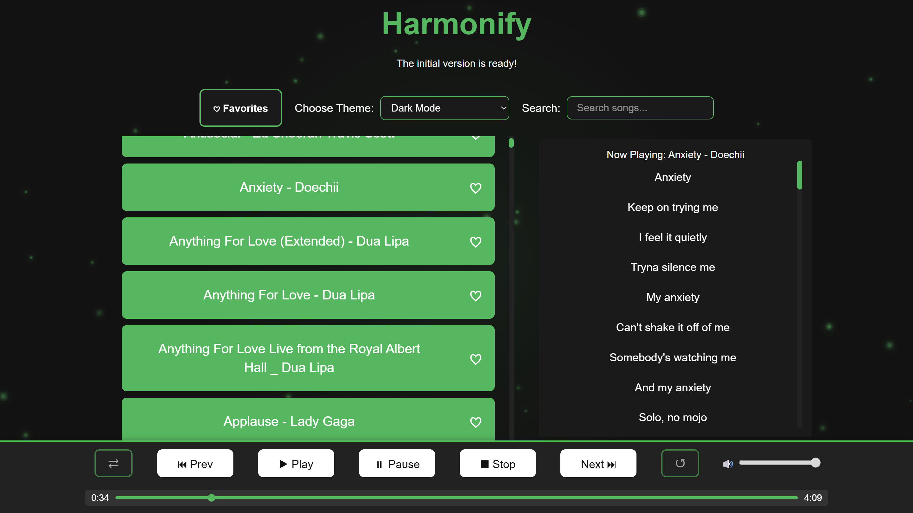
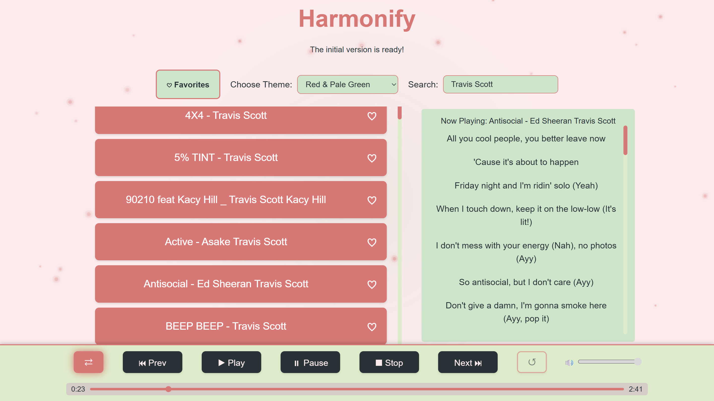
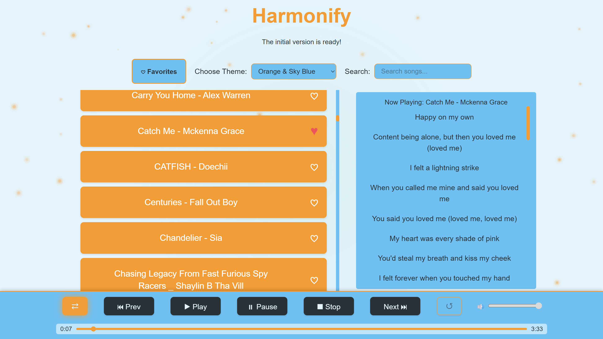
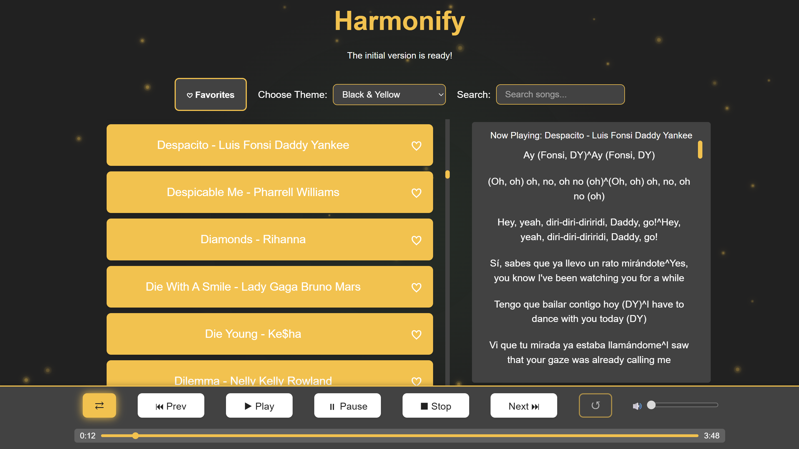

# 🎵 Harmonify

A beautiful, feature-rich desktop music player built with Electron, featuring automatic lyrics fetching, multiple themes, and a stunning star rain animation.

## ✨ Features

### 🎵 Music Playback
- Play MP3 files from your local Music folder
- Full playback controls (Play, Pause, Stop, Next, Previous)
- Progress bar with seek functionality
- Auto-play next song

### 📝 Automatic Lyrics
- Fetches lyrics from multiple free APIs:
  - **LRCLIB** - Large database with synced lyrics
  - **Lyrics.ovh** - Fast and reliable
  - **Some Random API** - Backup source
- Smart song name parsing (supports `Title - Artist` and `Artist - Title` formats)
- Lyrics caching for faster loading
- Parallel API requests with 5-second timeout

### 🎨 Beautiful Themes
Choose from 8 stunning color themes:
- 🌙 Dark Mode
- ☀️ Light Mode
- 🔵 Blue Theme
- 🌸 Red & Pale Green
- 🌿 Grass Green & Purple
- 🌅 Orange & Sky Blue
- 🟣 Purple & Yellow
- 🐝 Black & Yellow

## 📸 Screenshots

<table>
  <tr>
    <td><br/><b>Dark Mode</b></td>
    <td><br/><b>Light Mode</b></td>
  </tr>
  <tr>
    <td><br/><b>Blue Theme</b></td>
    <td><br/><b>Red & Green</b></td>
  </tr>
  <tr>
    <td><br/><b>Grass Purple</b></td>
    <td><br/><b>Orange Skyblue</b></td>
  </tr>
  <tr>
    <td><br/><b>Purple Yellow</b></td>
    <td><br/><b>Black Yellow</b></td>
  </tr>
</table>

### 🔀 Playback Modes
- **Shuffle Mode** - Random playback with Fisher-Yates algorithm
- **Repeat Modes** - Off, Repeat All, Repeat One

### 🔊 Volume Control
- Smooth volume slider
- Mute/Unmute with one click
- Volume saved across sessions

### ❤️ Favorites System
- Like your favorite songs with heart icon
- Filter to show only favorited songs
- Favorites saved in localStorage

### 🔍 Search
- Real-time song search
- Works together with favorites filter
- Clear search with Escape key

### ✨ Visual Effects
- **Cursor Glow** - Soft light follows your mouse
- **Star Rain** - Animated stars falling with theme colors
- **Smooth Animations** - Beautiful hover effects everywhere

### ⌨️ Keyboard Shortcuts
| Shortcut | Action |
|---|---|
| `Ctrl + S` | Toggle Shuffle |
| `Ctrl + R` | Toggle Repeat |
| `M` | Mute/Unmute |
| `↑ / ↓` | Volume Up/Down |
| `Escape` | Clear Search |

## 🚀 Installation

### Prerequisites
- [Node.js](https://nodejs.org/) (v16 or higher)
- npm (comes with Node.js)

### Steps

**1. Clone the repository**
```bash
git clone https://github.com/DrGhost019/harmonify.git
cd harmonify
```

**2. Install dependencies**
```bash
npm install
```

**3. Add your music**
```bash
Create a Music folder in the project root (if not exists)
Add your MP3 files to the Music folder
Follow the naming convention: Title - Artist.mp3 or Artist - Title.mp3
```

**4. Set up environment variables**
```bash
# Copy the example env file
cp .env.example .env

# Edit .env and add your Some Random API token
# Get your token from: https://some-random-api.com/
```

**5. Run the app**
```bash
npm start
```

## 📁 Project Structure

```
Harmonify/
├── main.js              # Electron main process
├── renderer.js          # UI logic and lyrics fetching
├── index.html            # HTML structure
├── style.css             # Styles and 8 themes
├── package.json          # Dependencies and scripts
├── .env                  # Environment variables (API tokens)
├── .gitignore             # Git ignore rules
├── README.md              # This file
├── Music/                 # Your MP3 files
│   └── README.md          # Music folder documentation
└── fonts/                 # Custom fonts (Inter, Roboto)
    └── README.md          # Font licenses
```

## 🎤 Lyrics Support
Harmonify automatically fetches lyrics based on your filename. For best results:

**Recommended Formats:**
- ✅ `Title - Artist.mp3` (e.g., "90210 - Travis Scott.mp3")
- ✅ `Artist - Title.mp3` (e.g., "Travis Scott - 90210.mp3")
- ✅ `Title (feat. Artist) - Main Artist.mp3`

**Tips:**
- Use English names for better matching
- Remove extra info like (Official Video), [HD]
- Keep filenames clean and simple

## 🛠️ Development

### Available Scripts
```bash
npm start      # Run the app in development mode
npm test       # Run tests (if configured)
```

### Building for Production
```bash
# Install electron-builder
npm install electron-builder --save-dev

# Build for your platform
npx electron-builder --win    # Windows
npx electron-builder --mac    # macOS
npx electron-builder --linux  # Linux
```

## 🎨 Customization

### Adding New Themes
Edit `style.css` and add a new theme class:
```css
body.my-theme {
  --bg-color: #your-color;
  --text-color: #your-color;
  --accent-color: #your-color;
  /* ... other variables */
}
```
Then add it to the theme selector in `index.html`.

### Changing Star Rain Intensity
In `renderer.js`, modify:
```js
const STAR_COUNT = 50; // Increase for more stars
```

## 📝 License
This project is licensed under the ISC License - see the LICENSE file for details.

## 🙏 Acknowledgments
- [Howler.js](https://howlerjs.com/) - Audio library
- [LRCLIB](https://lrclib.net/) - Lyrics database
- [Lyrics.ovh](https://lyrics.ovh/) - Lyrics API
- Some Random API - Backup lyrics API
- Google Fonts - Inter and Roboto fonts

## 🤝 Contributing
Contributions, issues, and feature requests are welcome!
1. Fork the project
2. Create your feature branch (`git checkout -b feature/AmazingFeature`)
3. Commit your changes (`git commit -m 'Add some AmazingFeature'`)
4. Push to the branch (`git push origin feature/AmazingFeature`)
5. Open a Pull Request

## 📧 Contact
**Your Name** - [@DrGhost019](https://github.com/DrGhost019) - moienkashefi.19@gmail.com

Project Link: [https://github.com/DrGhost019/harmonify](https://github.com/DrGhost019/harmonify)

---

Made with ❤️ and 🎵
