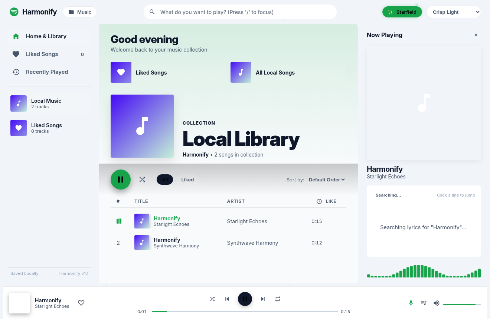
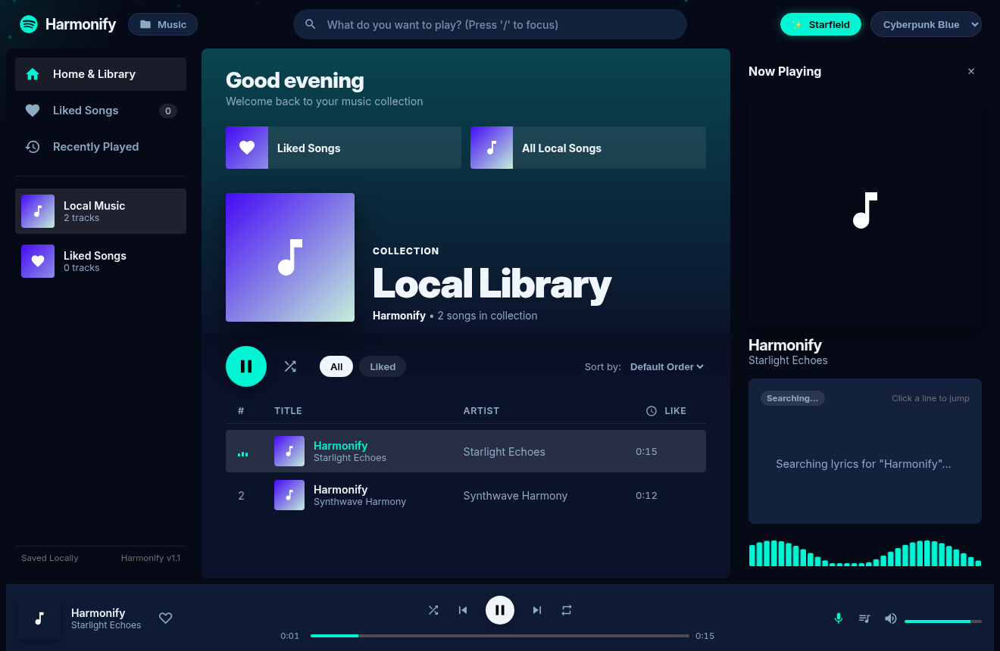
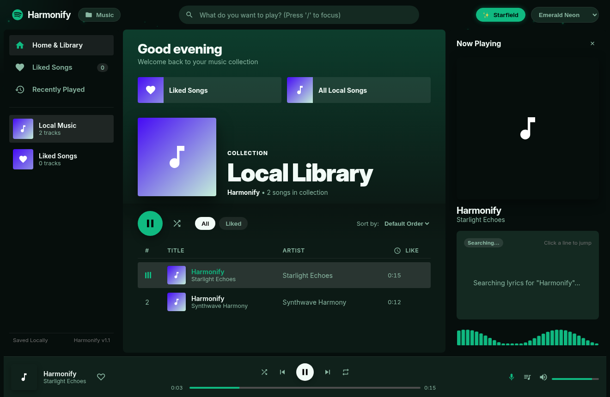
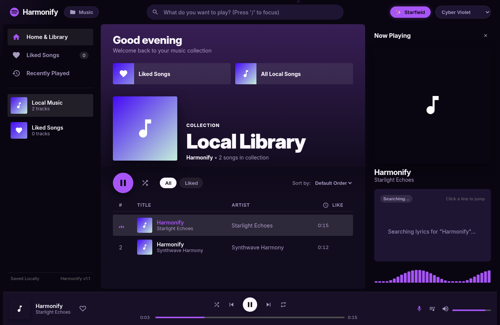

# 🎵 Harmonify - Listen to your dreams

<div align="center">


**A modern, top-tier desktop and web music player crafted with an iconic Spotify aesthetic, real-time synchronized karaoke lyrics, interactive animated waveform timeline, automatic local library indexing, server-side ID3 album art extraction, RFC 7233 byte-range audio streaming, ambient starfield canvas animations, and 8 handcrafted dynamic themes.**

*Built from the ground up with **Next.js (App Router)**, **React 19**, **TypeScript**, and **Tailwind CSS**.*

[Features](#-features) • [Screenshots](#-screenshots) • [Architecture](#-architecture) • [API Routes](#-api-routes) • [Installation](#-installation) • [Keyboard Shortcuts](#-keyboard-shortcuts)

</div>

---

## ✨ Features

### 🎨 Brand Identity: "Harmonify - Listen to your dreams"
- **Dynamic Theme-Reactive Vector Logo**: An emblem blending harmonic frequency resonance waves and the letter **"H"** into an iconic musical symbol.
  - On the site, the logo dynamically and smoothly adopts the active accent color across all 8 themes.
  - On the browser tab (favicon), the logo proudly displays the signature vibrant green (`#1ED760`).
- **Brand Slogan**: *"Harmonify - Listen to your dreams"*.

---

### 🎧 Spotify-Inspired 3-Tier Layout
- **Left Sidebar**:
  - Quick navigation (*Home & Library*, *Liked Songs*, *Recently Played*).
  - Dynamic track counters and collection shortcuts.
- **Center Main View**:
  - **Dynamic Time-Aware Greeting**: Welcomes you with *Good morning*, *Good afternoon*, or *Good evening*.
  - **Quick-Access Cards**: Instant-play cards for Liked Songs and All Songs with floating hover play buttons.
  - **Collection Hero Banner**: Displays collection artwork, track count, total duration, and quick playback controls.
  - **Spotify-Standard Track Table**:
    - **Col 1 (`#`)**: Track index, hover play/pause button, or animated 3-bar equalizer (`|||`) when playing.
    - **Col 2 (`Title`)**: 40×40px album artwork thumbnail + **Song Title** in bold text + **Artist Name** in subtle text below.
    - **Col 3 (`Album`)**: Dedicated **Album Name** column.
    - **Col 4 (`Like`)**: Heart favorite toggle button.
    - **Col 5 (`Duration`)**: Exact track duration (e.g. `3:31`, `4:38`) right-aligned under the clock icon.
  - **Smart Sorting & Filtering**: Filter by All or Liked Songs, and sort by *Default*, *Title (A-Z)*, *Artist (A-Z)*, *Album (A-Z)*, or *Duration*.
- **Collapsible Right Panel (Now Playing & Synced Lyrics)**:
  - High-res Now Playing album artwork card.
  - Song title, artist name, and album tag with disc badge.
  - **Full-height Synced Karaoke Lyrics**: Clear typography with smooth centering and active line scaling.
- **Persistent Spotify Bottom Bar**:
  - Mini album cover, track title, artist, and heart button with micro-animation.
  - Playback controls: Shuffle, Previous, circular Play/Pause, Next, and 3-state Repeat (*Off ➔ Repeat All ➔ Repeat One with a "1" badge*).
  - **Animated Waveform Timeline**: Interactive soundwave scrubber replacing standard flat slider bars.
  - Lyrics toggle button (`🎤`), Queue drawer toggle (`📑`), and volume slider with dynamic speaker icon states.

---

### 🌊 Interactive Animated Waveform Timeline
- **Live Soundwave Canvas**: A 72-bar reactive audio waveform canvas dynamically rendered on the playback scrubber.
- **Song-Specific Waveform Geometry**: Generates a distinct soundwave profile for every track based on its audio signature.
- **Dynamic Undulating Waves**: While music is playing, the wave bars undulate with live harmonic sine-wave oscillations.
- **Theme Accent Glow**: Played bars glow in your active theme's accent color (`var(--accent)`), while upcoming bars remain sleek and translucent.
- **Hover Timestamp Tooltip & Scrubbing**: Hovering anywhere over the waveform displays a floating time pill (e.g., `1:42`), and clicking or dragging smoothly seeks to that exact position.

---

### 🎤 Synchronized Karaoke Lyrics & Instant Click-to-Seek
- **Millisecond Timestamp Synchronization**:
  - **Priority 1 (Local Embedded)**: Automatically reads embedded ID3 synchronized lyrics (`syncText` / `SYLT`) directly from local audio files and companion `.lrc` files in **under 25 ms**.
  - **Priority 2 (Disk & Memory Cache)**: Caches lyrics locally in `.lyrics_cache.json` for **< 1 ms** subsequent loading.
  - **Priority 3 (Online Multi-Source)**: Parallel queries to **LRCLIB** (exact and cleaned title/artist search) and **Lyrics.ovh**.
- **Spotify-Style Click-to-Seek**: Click on **any lyric line** to immediately seek the song to that exact moment and auto-resume playback.
- **Dynamic Centering**: The active line scales up (`scale-[1.03]`), illuminates with the theme's accent color, and smoothly auto-scrolls to the center of the panel.

---

### 📁 Automatic Local Music Library Indexing (780+ Tracks)
- **Zero-Configuration Auto-Discovery**: Automatically indexes all audio files (`.mp3`, `.wav`, `.flac`, `.ogg`, `.m4a`, `.aac`) present in the `./Music` directory.
- **Persistent Library Cache (`.library_cache.json`)**: Reads 780+ songs in **under 2 ms** on app startup by caching ID3 tags (`title`, `artist`, `album`, `duration`) and detecting file modifications via `mtime`.
- **Dedicated Cover Art Streaming (`/api/cover`)**: Extracts embedded album art directly from ID3 tags and serves raw JPEG/PNG buffers with `Cache-Control: public, max-age=604800, immutable`, with a sleek dark fallback SVG when none is embedded.
- **RFC 7233 Byte-Range Streaming (`/api/stream`)**: Supports `Range: bytes=start-end` (`HTTP 206 Partial Content`), allowing immediate seek buffering without full file downloads.

---

### 🎨 8 Handcrafted Themes
Switch seamlessly between 8 themes, each tailored with distinct gradients, elevated cards, and accent colors:
- 🌙 **Spotify Dark** *(Default)* — Signature Spotify deep charcoal, pitch-black sidebar, and vibrant `#1ED760` green.
- ☀️ **Crisp Light** — Modern studio light aesthetic with soft shadows and emerald accents.
- 🔵 **Cyberpunk Blue** — High-contrast midnight navy and luminous cyan teal.
- 🐝 **Midnight Gold** — Pure OLED pitch black with warm amber accents.
- 🌿 **Emerald Neon** — Deep forest tones with neon emerald glows.
- 🟣 **Cyber Violet** — Deep space indigo with electric purple accents.
- 🌅 **Sunset Orange** — Warm espresso background with blazing sunset amber.
- 🌸 **Crimson Rose** — Rich dark burgundy with vivid rose-pink highlights.

---

### 🌌 Ambient Starfield Canvas
- **Falling Stars Animation**: Optimized background canvas with twinkling glow effects matching the active theme's accent color.
- **Interactive Cursor Glow**: Ambient illumination trails cursor movements across the interface.
- **Toggleable Switch**: Enable or disable the ambient starfield anytime with the header button.

---

## 📸 Screenshots

<table>
  <tr>
    <td align="center"><b>Spotify Dark (Default)</b><br/></td>
    <td align="center"><b>Crisp Light Mode</b><br/></td>
  </tr>
  <tr>
    <td align="center"><b>Cyberpunk Blue</b><br/></td>
    <td align="center"><b>Midnight Gold</b><br/></td>
  </tr>
  <tr>
    <td align="center"><b>Emerald Neon</b><br/></td>
    <td align="center"><b>Cyber Violet</b><br/></td>
  </tr>
  <tr>
    <td align="center"><b>Sunset Orange</b><br/></td>
    <td align="center"><b>Crimson Rose</b><br/></td>
  </tr>
</table>

---

## ⌨️ Keyboard Shortcuts

| Shortcut | Action |
|---|---|
| <kbd>Space</kbd> | Play / Pause playback |
| <kbd>←</kbd> (Left Arrow) | Seek backward 5 seconds |
| <kbd>→</kbd> (Right Arrow) | Seek forward 5 seconds |
| <kbd>↑</kbd> (Up Arrow) | Volume Up (+5%) |
| <kbd>↓</kbd> (Down Arrow) | Volume Down (-5%) |
| <kbd>M</kbd> | Mute / Unmute audio |
| <kbd>Ctrl</kbd> + <kbd>S</kbd> | Toggle Shuffle mode |
| <kbd>Ctrl</kbd> + <kbd>R</kbd> | Cycle Repeat mode (*Off ➔ All ➔ One*) |
| <kbd>/</kbd> | Focus Search bar |
| <kbd>Escape</kbd> | Clear Search / Close Queue Drawer |

---

## 🛠️ Tech Stack & Architecture

- **Frontend**:
  - [Next.js 16](https://nextjs.org/) (App Router, Turbopack)
  - [React 19](https://react.dev/) (Hooks, Context API, Suspense)
  - [TypeScript 5](https://www.typescriptlang.org/) (Strict mode, full type safety)
  - [Tailwind CSS 3.4](https://tailwindcss.com/) (Custom CSS variables, responsive design)
  - [Lucide React](https://lucide.dev/) (Pixel-perfect icons)
  - [Howler.js](https://howlerjs.com/) (HTML5 audio engine with spatial support)
- **Backend (Next.js Route Handlers)**:
  - Node.js native filesystem streaming & RFC 7233 Range requests
  - [music-metadata](https://github.com/Borewit/music-metadata) (ID3 tag, SYLT lyrics, and embedded artwork decoder)
  - Multi-tier caching (`.library_cache.json`, `.lyrics_cache.json`)

---

## 📡 API Routes

| Endpoint | Method | Description |
|---|---|---|
| `/api/songs` | `GET` | Automatically indexes `./Music`, caches metadata, and returns JSON track list with album and cover URLs. |
| `/api/cover?song=` | `GET` | Extracts and serves embedded album cover images (JPEG/PNG) with long-term browser cache headers. |
| `/api/stream?song=` | `GET` | Streams audio file with HTTP Range support (`status 206`) for instant seeking. |
| `/api/lyrics?filename=&artist=&title=` | `GET` | Reads local embedded SYLT lyrics or fetches from LRCLIB/Lyrics.ovh with caching. |
| `/api/metadata?song=` | `GET` | Returns on-demand ID3 tag inspection and high-res cover art. |

---

## 🚀 Getting Started

### Prerequisites
- [Node.js](https://nodejs.org/) (v18.17+ or higher recommended)
- npm (bundled with Node.js)

### 1. Clone & Install
```bash
git clone https://github.com/DrGhost019/harmonify.git
cd harmonify
npm install
```

### 2. Add Your Music
Place your music files (`.mp3`, `.flac`, `.wav`, `.ogg`, `.m4a`, `.aac`) into a folder named `music` (or `Music`) in the project root directory. Harmonify will automatically scan, index, and organize your entire collection upon startup without modifying your files.

### 3. Run Development Server
```bash
npm run dev
```
Open [http://localhost:3000](http://localhost:3000) in your browser.

### 4. Build for Production
```bash
npm run build
npm start
```

---

## 📂 Project Structure

```text
Harmonify/
├── app/
│   ├── layout.tsx             # Root layout with brand title, metadata, green icon
│   ├── page.tsx               # Main Spotify-style dashboard
│   ├── globals.css            # Tailwind + CSS custom properties for 8 themes
│   ├── icon.svg               # Vibrant green browser tab icon
│   └── api/
│       ├── songs/             # GET: scans Music folder, caches ID3 tags
│       ├── cover/             # GET: extracts & streams embedded album artwork
│       ├── stream/            # GET: RFC 7233 byte-range audio streaming
│       ├── lyrics/            # GET: embedded SYLT & LRCLIB synced lyrics
│       └── metadata/          # GET: on-demand ID3 tag inspection
├── components/
│   ├── Logo.tsx               # Theme-reactive vector logo
│   ├── TopBar.tsx             # Brand header, search, theme selector, starfield toggle
│   ├── Sidebar.tsx            # Navigation, library stats, liked songs
│   ├── MainView.tsx           # Greeting hero, quick cards, banner, track table
│   ├── TrackRow.tsx           # Spotify track row (index, cover, title, artist, album, like, duration)
│   ├── WaveformTimeline.tsx   # Interactive animated audio soundwave scrubber
│   ├── BottomPlayer.tsx       # Persistent Spotify player bar with waveform
│   ├── LyricsPanel.tsx        # Synced lyrics with click-to-seek & auto-centering
│   ├── QueueDrawer.tsx        # Slide-out queue drawer
│   └── StarfieldCanvas.tsx    # Ambient falling stars canvas animation
├── context/
│   └── AudioContext.tsx       # Global audio state with Howler, lyricsRef, shortcuts
├── types/
│   └── index.ts               # Song, LyricLine, ThemeId, RepeatMode, FilterMode, SortMode
├── tailwind.config.ts         # Tailwind theme & color variable definitions
├── tsconfig.json              # TypeScript configuration
├── next.config.mjs            # Next.js configuration
├── Music/                     # Local audio collection (.mp3, .flac, .wav, etc.)
├── public/                    # Static assets, screenshots, and icon.svg
└── package.json               # Manifest & scripts
```

---

## 📝 License

This project is licensed under the **ISC License** — see the [LICENSE](LICENSE) file for details.

---

## 👤 Author & Acknowledgments

- **Author**: Mohammad Moein Kashefi Nejad ([@DrGhost019](https://github.com/DrGhost019))
- **Framework**: [Next.js](https://nextjs.org/) & [React](https://react.dev/)
- **Styling**: [Tailwind CSS](https://tailwindcss.com/)
- **Icons**: [Lucide React](https://lucide.dev/)
- **Audio Engine**: [Howler.js](https://howlerjs.com/)
- **Lyrics Database**: [LRCLIB](https://lrclib.net/)
- **Metadata Parser**: [music-metadata](https://github.com/Borewit/music-metadata)
